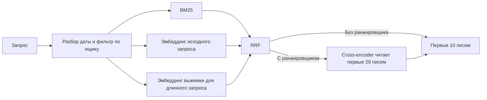

# ML-кандидаты для поиска по почте

На расширенном наборе лучший nDCG@10 получил гибрид **BM25 + Granite 97M с RuModernBERT после RRF**. Его nDCG@10 составил **0,5747** при серверном **p99 629,73 мс**. Ниже описаны все пять проверенных конфигураций, контрольный BM25 и дополнительный ранжировщик BGE.

На 99 исходных запросах организаторов лучший точечный результат у гибрида **BM25 + Harrier 270M** с nDCG@10 **0,9815** и серверным **p99 22,28 мс**. [Отдельный замер на исходных запросах](../models.md#результаты-на-99-исходных-запросах)

## Данные

**429 новых поисковых случаев** в 12 ящиках. Каждый случай представлен кратким и длинным запросом с одинаковой разметкой, всего 858 запросов и 5 536 связей «запрос — релевантное письмо». Публичные данные организаторов сохранены отдельно. Целевые письма новых случаев не пересекаются с положительной разметкой организаторов и с целями других новых случаев.

| Группа | Случаи | Источник разметки |
|---|---:|---|
| Событие и сумма | 260 | Тип уведомления по шаблону темы и точное значение суммы в теле |
| Упоминание кода | 100 | Точное присутствие кода в письмах доступного ящика |
| Событие за день | 69 | Тип уведомления по шаблону темы, ящик и день получения вне размеченных публичных дней |

Пары размечены по содержимому синтетических писем до запуска моделей. Структурированные случаи используют однозначные шаблоны, суммы и коды. Для длинной версии цель поиска помещена в начало, середину или конец среди постороннего контекста. Медианная длина этой версии — 1 172 символа, 143 запроса превышают 512 токенов токенизатора E5. Это контролируемые сценарии по имеющемуся почтовому архиву, с разметкой по правилам.

[Запросы](queries.jsonl) · [Оценки релевантности](qrels.jsonl) · [Генератор](../build_expanded.py)

## Общая схема поиска



1. **Подготовка писем.** SQLite FTS5 индексирует тему и тело. Энкодер заранее строит один нормализованный вектор из исходного текста письма, где есть тема и тело. Векторы хранятся в локальном кэше, повторные запросы переиспользуют их. Лимит входа энкодеров — 512 токенов. [Индексация](../../mail_search/embeddings.py)
2. **Разбор запроса.** Дата извлекается до поиска. «Вчера» и другие относительные даты вычисляются от даты отсчёта. Все ветки ограничиваются выбранным ящиком и письмами, доступными на дату отсчёта. При указании конкретного дня подходят только письма с этой датой получения. Фильтры применяются до отбора top‑K. [Код поиска](../../mail_search/search.py)
3. **Получение кандидатов.** BM25 ищет по словам и русским префиксам и сильнее учитывает тему. Векторная ветка кодирует исходный запрос без выделенной даты и сортирует разрешённые письма по косинусной близости. При лимите выдачи 10 каждая ветка может подать в RRF до 50 писем.
4. **Выжимка запроса.** Для текста от 180 символов правила выделяют фразу с целью поиска и явные уточнения. Выжимка ограничена 480 символами и должна быть более чем на 20% короче исходного текста. Она кодируется тем же энкодером и ищется по тем же векторам писем. Если выжимка содержит распознанный точный код, номер или сумму, защищённый режим сохраняет две ветки. Идентичный список совпадений от двух эмбеддингов даёт один голос. API принимает до 4 000 символов. [Правила выжимки](../../mail_search/query_summary.py)
5. **Итоговый порядок.** RRF складывает вклады `1 / (60 + позиция)` по спискам. Если настроен cross-encoder, он получает до 20 первых кандидатов RRF. Модель читает пары «исходный запрос без выделенной даты — письмо» с лимитом 512 токенов на пару и пересортировывает кандидатов по логиту. При единственном кандидате скоринг пропускается. Клиент получает первые 10 писем в бенчмарке. [Код ранжировщика](../../mail_search/torch_models.py)

## Архитектуры кандидатов

Пять конфигураций выбраны по [предыдущему прогону](../models.md). Каждая уложилась в лимит серверного p99 в 1 секунду на том наборе. В расширенном эксперименте у каждой сравнивали тот же гибрид до и после добавления выжимки. Контрольный BM25 оценивали отдельно.

### 1. BM25 + E5-small

`--embedder e5` использует `intfloat/multilingual-e5-small` в ONNX INT8 на CPU. Модель получает префикс `passage:` для письма и `query:` для исходного запроса и выжимки. Вектор размерности 384 получается усреднением состояний токенов с маской и L2-нормализацией. Локальный кэш позволяет кодировать только вход запроса в момент поиска. После RRF порядок писем готов к выдаче. Это контрольный гибрид из первого прототипа. [Замер по запросам](guarded-runs/e5.json)

### 2. BM25 + Granite 97M

`--embedder granite97` использует `ibm-granite/granite-embedding-97m-multilingual-r2` на ModernBERT. Префиксы у письма и запроса пустые. Берётся представление первого токена CLS размерности 384, затем выполняется L2-нормализация. В обоих векторных каналах используется один и тот же индекс Granite. Итоговый порядок определяет RRF. Этот же энкодер подбирает кандидатов в опыте с RuModernBERT и в предыдущем сравнении ранжировщиков. [Замер по запросам](guarded-runs/granite97.json)

### 3. BM25 + USER2-small

`--embedder user2-small` использует `deepvk/USER2-small` на RuModernBERT. Энкодер получает `search_document:` для письма и `search_query:` для обеих форм запроса. Состояния непустых токенов усредняются в вектор размерности 384, который затем нормализуется. Как и у остальных энкодеров в этом тесте, вход ограничен 512 токенами. RRF объединяет семантические и лексические совпадения для выдачи. [Замер по запросам](guarded-runs/user2-small.json)

### 4. BM25 + Harrier 270M

`--embedder harrier270` использует `microsoft/harrier-oss-v1-270m` на Gemma 3 Text. Письмо передаётся как есть. К исходному запросу и выжимке добавляется инструкция поиска `web_search_query` из конфигурации модели. Вектор строится из состояния последнего непустого токена, имеет 640 измерений и нормализуется. Выдача берётся из RRF. На расширенном наборе Harrier занял первое место среди гибридов с одним этапом ранжирования. [Замер по запросам](guarded-runs/harrier270.json)

### 5. BM25 + Granite 97M + RuModernBERT

`--embedder granite97 --reranker ru-reranker` сохраняет получение кандидатов Granite и порядок RRF как вход для второго этапа. Cross-encoder `n-bor1sov/RuModernBERT-base-reranker-ru` на RuModernBERT одновременно видит запрос и текст одного письма. Он оценивает пары батчем и сортирует до 20 кандидатов по полученным логитам. Второй этап может поднять письмо с 20-й позиции RRF в первую десятку. Письма за пределами этого пула в скоринг не попадают. [Замер по запросам](guarded-runs/granite-ru.json)

### Контроль BM25

В режиме `bm25` работает FTS5 с весами `3,0` для темы и `1,0` для тела. BM25 учитывает редкость и частоту совпавших токенов, а также длину проиндексированного текста. Этот режим показывает вклад лексических совпадений на наборе с большим числом точных кодов и сумм. [Контрольный замер](guarded-runs/e5.json)

### Дополнительный вариант с BGE

`--embedder granite97 --reranker bge-reranker` использует `BAAI/bge-reranker-v2-m3` на XLM-RoBERTa вместо RuModernBERT. Первый этап по-прежнему находит письма через BM25 и Granite, второй оценивает пары «запрос — письмо» и сортирует top‑20 по логиту. В предыдущем эксперименте хеши упорядоченных списков кандидатов для BGE и RuModernBERT совпали. На расширенном наборе из 858 запросов BGE не прогоняли, потому что его серверный p99 на предыдущем наборе превысил 1 секунду. [Замер BGE](../ml-granite-bge-reranker.json) · [Сравнение ранжировщиков на предыдущем наборе](../models.md#результаты-второго-этапа)

| Предыдущий набор, 99 запросов в группе | Recall@10 | nDCG@10 | p99, мс |
|---|---:|---:|---:|
| Исходные запросы | 0,9265 | 0,9726 | 1 160,36 |
| Перефразировки с датой | 0,8245 | 0,8378 | 1 020,91 |
| Перефразировки без дня | 0,2627 по известным целям | — | 1 235,37 |

## Сравнение

Каждая конфигурация проходит одинаковые запросы через HTTP. Для неё сравниваются две ветки и гибрид с вектором выжимки. Если выжимка не применяется, краткие запросы и запросы с точным реквизитом используют общий результат двух идентичных вычислений. На длинных запросах с активной выжимкой порядок вызовов обоих вариантов перемешан. Recall@10 показывает среднюю долю релевантных писем в первой десятке. nDCG@10 сильнее учитывает релевантные письма в начале выдачи. Серверный p99 измерен после прогрева на Apple M4 Pro от разбора HTTP-запроса до сериализации ответа. E5 работал в ONNX INT8 на CPU, остальные модели — в BF16 на MPS.

Критерий сравнения кандидатов — средний nDCG@10 по паре краткого и длинного запроса. Разницу оцениваем парным блочным бутстрэпом с 20 000 повторов. Один блок — ящик и опорный день релевантного письма. Парные формулировки попадают в один блок. Для десяти сравнений используется поправка Бонферрони на общий уровень доверия 95%. Интервал, включающий ноль, оставляет модели неразличимыми по этим данным.

Первый прогон проверял дополнительный голос RRF и на точных запросах. У Granite с RuModernBERT на длинных запросах о событиях за день nDCG@10 вырос с 0,5817 до 0,6337, а на запросах с точной суммой упал с 0,2106 до 0,1132. Защита сумм, номеров и кодов была выбрана по этому прогону. Повторный замер с защитой оценивает её на том же тесте, поэтому оценка эффекта защиты относится к этому набору. [Результаты первого прогона](raw-results.json)

## Результаты с защитой точных запросов

| Конфигурация | Recall@10 | nDCG@10 | p99, мс | Δ nDCG@10 на длинных против двух веток |
|---|---:|---:|---:|---:|
| **Granite 97M + RuModernBERT** | **0,5569** | **0,5747** | 629,73 | +0,0084 |
| Harrier 270M | 0,4921 | 0,3690 | 65,60 | +0,0093 |
| E5-small | 0,4576 | 0,3584 | 72,80 | +0,0189 |
| Granite 97M | 0,4577 | 0,3493 | 26,52 | +0,0117 |
| USER2-small | 0,4466 | 0,3219 | 26,47 | +0,0074 |
| BM25, контроль | 0,5462 | 0,4588 | 9,75 | — |

У всех пяти кандидатов в таблице есть BM25 и RRF. Между Granite с RuModernBERT и Harrier, вторым из пяти кандидатов, разница составляет **+20,57 п. п. nDCG@10**, скорректированный интервал `[+16,97; +25,28]` п. п. Преимущество лидера подтверждено во всех четырёх сопоставлениях. BM25 оказался сильным контролем на наборе с большим числом точных сумм и кодов. Выжимка строилась для 69 из 429 длинных запросов. [Сравнительный отчёт и интервалы](results.json) · [Замеры по каждому запросу](guarded-runs)

### Метрики по длине запроса

| Конфигурация | Короткие Recall@10 / nDCG@10 | Длинные Recall@10 / nDCG@10 | nDCG@10 длинных, две ветки → с защитой |
|---|---:|---:|---:|
| Granite 97M + RuModernBERT | 0,8389 / 0,8592 | 0,2750 / 0,2902 | 0,2819 → 0,2902 |
| Harrier 270M | 0,7472 / 0,5321 | 0,2369 / 0,2059 | 0,1966 → 0,2059 |
| E5-small | 0,6960 / 0,5109 | 0,2191 / 0,2058 | 0,1869 → 0,2058 |
| Granite 97M | 0,7041 / 0,5071 | 0,2114 / 0,1914 | 0,1797 → 0,1914 |
| USER2-small | 0,6839 / 0,4656 | 0,2092 / 0,1782 | 0,1709 → 0,1782 |
| BM25, контроль | 0,8278 / 0,6886 | 0,2647 / 0,2290 | — |

## Повторение замера

Из корня репозитория, под Python с установленными моделями и `requirements-ml.txt`:

```sh
result_dir=/tmp/mail-expanded-runs
mkdir -p "$result_dir"
python -m mail_search evaluate-expanded --embedder e5 --bm25-control --output "$result_dir/e5.json"
for model in granite97 user2-small harrier270; do
  python -m mail_search evaluate-expanded --embedder "$model" --output "$result_dir/$model.json"
done
python -m mail_search evaluate-expanded --embedder granite97 --reranker ru-reranker \
  --output "$result_dir/granite-ru.json"
python -m benchmarks.summarize_expanded --runs "$result_dir" --output /tmp/mail-expanded-results.json
```

Флаг `--raw-summary` у `evaluate-expanded` повторяет эксперимент без защиты точных запросов. Для него нужен отдельный каталог результатов.
