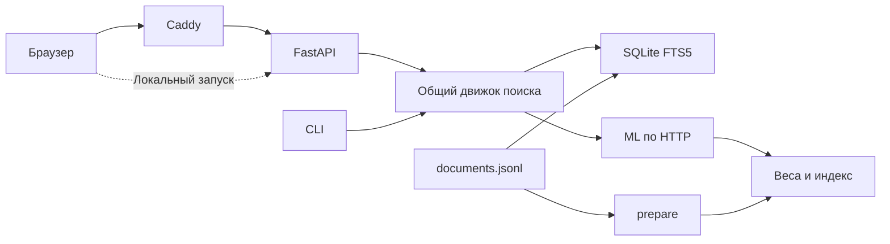

# Инфраструктура поиска



FastAPI обслуживает интерфейс, письма и BM25. Веб-поиск и CLI вызывают один движок. ML хранит векторы и ранжирует смысловых кандидатов. Backend объединяет кандидатов через RRF и проверяет их принадлежность ящику и периоду. По умолчанию один процесс Uvicorn загружает SQLite FTS5 в память при запуске. Общая блокировка SQLite входит в измерение серверной задержки. [Контракт Backend ↔ ML](contracts/ml-search-v1.md)

## Локальный стенд

```sh
cp .env.example .env
MAIL_SEARCH_FRONTEND_V2=1 docker compose up --build -d --wait backend
curl -fsS http://127.0.0.1:8000/readyz
```

Откройте http://127.0.0.1:8000. Для первого запуска с моделью используйте одну и ту же конфигурацию корпуса и артефактов для подготовки, backend и ML.

```sh
docker compose run --build --rm --no-deps ml python -m mail_search prepare --profiles encoder-a,encoder-b
MAIL_SEARCH_FRONTEND_V2=1 SEARCH_MODE=hybrid MODEL_PROFILE=encoder-a docker compose --profile semantic up -d --wait
curl -fsS http://127.0.0.1:8000/readyz
```

Для смены модели повторите команду `up` с `MODEL_PROFILE=encoder-b`. Compose пересоздаст backend и ML с новым профилем. `/readyz` подтвердит фактически загруженный индекс. Для отката снова укажите `encoder-a`. Подготовленные артефакты остаются на диске. Для возврата к BM25 запустите `SEARCH_MODE=bm25 docker compose up -d --wait backend` и остановите ML командой `docker compose stop ml`.

| Переменная | По умолчанию | Назначение |
|---|---|---|
| `SEARCH_MODE` | `bm25` | `bm25`, `encoder`, `hybrid` |
| `MODEL_PROFILE` | `encoder-a` | Имя YAML-профиля |
| `ML_URL` | `http://ml:8001` в Compose | Адрес ML для backend. При запуске из venv используется `http://127.0.0.1:8001`. Можно указать адрес SSH-туннеля |
| `ML_TIMEOUT` | `0.5` | Таймаут сетевого запроса к ML в секундах |
| `DEMO_FALLBACK` | `0` | `1` разрешает BM25 при таймауте ML в гибридном веб-режиме |
| `MAIL_DATA` | `./mipt_mail_search_participants` | Каталог корпуса на хосте, монтируется в `/data` |
| `MODEL_PROFILES` | `./models/profiles` | Каталог профилей на хосте, монтируется в `/profiles` |
| `ML_ARTIFACTS` | `./.artifacts` | Постоянный каталог артефактов на хосте, монтируется в `/artifacts` |
| `MAIL_PORT` | `8000` | Порт backend на loopback хоста |
| `MAIL_DOMAIN` | `localhost` | DNS-имя публичного стенда для Caddy |
| `MAIL_RELEASE` | `local` | Тег образов backend и ML. Для публичной сборки задайте SHA коммита |
| `INSTALL_TRANSFORMERS` | `0` | Установить зависимости адаптера Sentence Transformers при сборке образа ML |

Адреса каталогов внутри контейнеров передаются через `DATA_DIR`, `PROFILE_DIR` и `ARTIFACT_DIR`. Ограничьте доступ к Docker-хосту и используйте для публичного демо корпус хакатона. Выбор ящика в UI предназначен для этого корпуса. Запросы к поиску и тексты писем не пишутся в журнал backend. При ошибке готовности проверьте `docker compose logs backend ml`, выбранный профиль и совпадение SHA-256 корпуса.

## Сравнение на отдельном стенде

Тестовый запуск использует Compose-проект с независимыми процессами. Путь для отчётов сохраняется на хосте через каталог `runs`.

```sh
docker compose -p mail-experiment run --build --rm --no-deps ml \
  python -m mail_search compare --profiles encoder-a,encoder-b --limit 10 --out runs/dev
```

На финальном нагрузочном замере остановите фоновые эксперименты и укажите целевой режим. Подробности о метриках, строгом режиме и воспроизведении прогона описаны в спецификации экспериментов. [Спецификация экспериментов](ml/experiments.md)

## Локальный интерфейс с ML на VM

Разверните только ML на VM. Используйте тот же `documents.jsonl`, что и в локальном backend, и подготовьте выбранный профиль. Дополнение `compose.vm.yaml` публикует ML на loopback VM.

```sh
# На VM
docker compose run --build --rm --no-deps ml python -m mail_search prepare --profiles encoder-a
MODEL_PROFILE=encoder-a docker compose -f compose.yaml -f compose.vm.yaml up -d --wait ml
```

На компьютере откройте отдельный терминал для туннеля. Замените `vm` на SSH-алиас или `user@host`.

```sh
ssh -N -o ExitOnForwardFailure=yes -L 127.0.0.1:18001:127.0.0.1:8001 vm
```

В другом локальном терминале проверьте профиль и запустите backend из venv на свободном порту.

```sh
curl -fsS http://127.0.0.1:18001/readyz
MAIL_SEARCH_FRONTEND_V2=1 ML_URL=http://127.0.0.1:18001 SEARCH_MODE=hybrid MODEL_PROFILE=encoder-a \
  uv run --locked python -m mail_search serve --port 8002
curl -fsS http://127.0.0.1:8002/readyz
```

Откройте http://127.0.0.1:8002. Браузер обращается к локальному backend, а backend посылает запросы ML через туннель. Имя профиля должно совпадать на обеих машинах. Чтобы измерить этот вариант, используйте локальный HTTP-адрес и учитывайте, что замер включает сетевой вызов к VM.

## Публичная CPU-VM и откат

На VM установите Docker с Compose, направьте DNS-имя на её публичный адрес и откройте для HTTP и HTTPS порты 80 и 443. В `.env` задайте `MAIL_DOMAIN`, `SEARCH_MODE`, `MODEL_PROFILE`. Заранее подготовьте артефакты выбранного профиля. Запуск BM25 использует профиль Compose `public`. Для `encoder` и `hybrid` добавьте `--profile semantic`.

```sh
export MAIL_RELEASE="$(git rev-parse --short HEAD)"
docker compose --profile public up --build -d --wait
curl -fsS "https://${MAIL_DOMAIN}/readyz" # MAIL_DOMAIN должен быть задан и в shell
```

На публичной VM и на ноутбуке используйте одну ревизию исходников и корпуса. Для отката сохраните предыдущий тег образов, конфигурацию и индекс. Запустите Compose с прежним `MAIL_RELEASE`, `MODEL_PROFILE` и каталогом корпуса, заменив `--build` на `--no-build`. После переключения проверьте `/readyz`, поиск и открытие письма. Заключительный замер делается на целевой VM. Зафиксируйте CPU, RAM, ревизии, p50/p95/p99 и ошибки, затем проверьте URL с другого устройства. При сбое внешнего стенда запустите локальный профиль BM25.
